<p align="center">
  
</p>

<h1 align="center">agy-pro</h1>

<p align="center">
  <strong>Zero-interruption multi-account pool, seamless 429 hot-swap &amp; live session monitor for Antigravity CLI (<code>agy</code>).</strong>
</p>

<p align="center">
  
  
  
  
  <a href="LICENSE"></a>
</p>

<p align="center">
  <a href="README.md"><strong>English</strong></a> · <a href="README_CN.md">简体中文</a>
</p>

<p align="center">
  
</p>

**agy-pro** is a pure-Go, single-binary, native multi-account wrapper for Google's Antigravity CLI (`agy`). It hands the real TTY directly to your locally installed `agy` binary — zero second-layer PTY wrapper, zero forced model overrides, zero OS trust-store or dotfiles mutations — and silently hot-swaps exhausted accounts mid-turn without interrupting running tasks.

---

## Key Features

- **Single Static Binary (Zero CGO)**: Prebuilt binaries for Linux, macOS, and Windows (`amd64` / `arm64`, PowerShell, CMD, and Windows Terminal) with one-line SHA-256 verified installers. Local commands (`status`, `usage`, `use`, `next`) finish in `< 5ms` with ~4 MB RSS.
- **Isolated Account Vault**: Stored under `~/.local/state/agy-pro/` (`%LOCALAPPDATA%\agy-pro\` on Windows) using official `AGY_CLI_FORCE_FILE_TOKEN_STORAGE=1` (no system Keychain writes, no `SSH_CONNECTION` spoofing). Auto-detects official `agy` (including `%LOCALAPPDATA%\agy\bin\agy.exe` on Windows) and supports zero-arg `agy-pro auth import` to onboard your existing active login immediately.
- **Seamless Zero-Interruption 429 Hot-Swap (Default Across All Platforms) + `--resume` Safety Net**:
  - Strict **drain** rotation (exhausts one account's 5h/7d pool before advancing; never bounces back) with configurable proactive reserve switching (`agy-pro config reserve 10` or `--reserve 10`).
  - **In-place mid-turn failover (default on Linux, macOS, and Windows)**: starts a child-scoped loopback HTTP/2 proxy with an ephemeral in-memory ECDSA CA bundled alongside system roots (exported read-only from the OS trust store / Windows `ROOT` store into a temporary `SSL_CERT_FILE` deleted on exit — never modifies the OS trust store). Intercepts **only** Google AI inference endpoints (all other domains pass through raw TCP untouched), pre-warms the next standby token in the background, and on `HTTP 429` / `RESOURCE_EXHAUSTED` transparently swaps the `Authorization: Bearer` token in milliseconds and replays the request — **zero process restart, zero TUI flicker, zero interrupted subagents or background tasks**.
  - **Automatic `--resume` fallback**: passing `--no-seamless` / `agy-pro config seamless off` (or hitting an unretryable mid-stream edge case) seamlessly falls back to proxy-free `agy --resume <id>` (`continue`), while a detached background verifier records exact 5h/7d reset timestamps and self-heals transient 429s.
  - Queries Gemini + Claude/GPT 5h/7d pools concurrently across all accounts via detached official `agy --print /usage` (100% upstream parity + automatic silent OAuth token renewal).
- **3-in-1 Interactive Dashboard (`agy-pro ui`) & Standalone `agy-pro usage`**:
  - **Pool (`1`)**: Live dual-pool quota bars with vertical pagination for large pools, drain priority reordering (`J`/`K`), reserve & Auto-compact tuning (`+/-`, `[/]/a`), login/remove (`l`/`d`), privacy email masking (`m`), and instant language toggle (`g`).
  - **Open Sessions (`2`)**: Detects truly open `agy` terminals on this machine in `< 0.5ms` via non-blocking kernel locks (`flock` on Unix / `LockFileEx` on Windows) over `~/.gemini/antigravity-cli/presence/*.lock` (covers both `agy-pro` and bare `agy`, plus live account & TTY display). Press `a` to toggle open-only vs. full history (hiding empty 0-step shells while keeping open windows pinned on top).
  - **Token Usage (`3` / `agy-pro usage`)**: Read-only parallel scanner over local `conversations/*.db` (`gen_metadata` + call-level step timestamps, rolling subagents up to parent sessions) showing exact per-model (`TOTAL / Input / Cache Read / Hit% / Output`, with automatic tail rollup) and Top-session token breakdown across **Today / 7 Days / All** (`--today` / `--7d` / `--all` / `--json`), with `Enter` / `Ctrl+N` in TUI to resume any session directly.
- **Interactive Session Picker (`agy-pro resume`)**: Pure-Go read-only SQLite picker (like `claude --resume`) that hides empty 0-step placeholders, defaults to the current directory, supports `Tab` CWD/All toggle, live multi-term search, `Enter` (current account) and `Ctrl+N` (next account) resume.
- **Privacy Mask Mode for Demos & Screenshots**: Pass `--mask`, set `AGY_PRO_MASK=1`, or press `m` live inside `agy-pro ui` to obscure account emails (`al***@gmail.com`) across every CLI table, TUI view, and launch banner.
- **Live Terminal Tab Title & Desktop Notifications**:
  - Syncs live session title (including in-session `/rename`) and run state (`⠋` working / `✦` idle / `↻` switching) to the terminal tab via atomic OSC 0 without PTY interception, clearing/restoring your original tab title on exit (`AGY_PRO_NO_TITLE=1` to disable).
  - Sends non-blocking desktop notifications (`notify-send` on Linux / `osascript` on macOS / WinRT Toast on Windows, silent on headless SSH) when a long turn (`>= 30s`) completes or on 429 failover (`agy-pro config notify on|off`).
- **Zero-Dotfile Default Auto-Compact (90%) & CJK OSC-8 Guard**:
  - Defaults `AGY_CLI_AUTO_COMPACT_OVERRIDE=90%` strictly on child `agy` processes (zero `~/.bashrc`/`~/.zshrc` or Windows `HKCU\Environment` edits unless you explicitly pass `--sync-shell`).
  - Defaults `AGY_CLI_FORCE_OSC8=0` (overridable via `AGY_CLI_FORCE_OSC8=1`) to prevent native `agy`'s un-escaped UTF-8 OSC-8 `0x9C`/`0x8D` Reverse Index cursor-up ghosting on CJK file paths.
  - Short cross-process `launch.lock` serializes concurrent multi-tab token handshakes (~45ms), and `TerminalGuard` unconditionally restores terminal state + Kitty Keyboard Protocol on failover.
- **Externalized i18n Packs (`en` / `zh`)**: Automatically follows your system locale (POSIX `LANG`/`LC_*` plus Windows user locale; `zh*` → Chinese, all others → English), configurable via `agy-pro config lang <auto|en|zh>`, `AGY_PRO_LANG`, or `g` inside `agy-pro ui`. All strings live in external JSON catalogs (`internal/i18n/locales/*.json`, with optional drop-in overrides in `<stateDir>/locales/`).

---

## Install & Quick Start

**Prerequisites**: Official `agy` CLI installed locally (no Go toolchain required for prebuilt releases).

**Linux / macOS** (downloads latest release, verifies SHA-256, installs to `~/.local/bin/agy-pro`):

```bash
curl -fsSL https://raw.githubusercontent.com/Tiggy-Chan/agy-pro/main/install.sh | sh
```

**Windows (PowerShell)** (installs to `%LOCALAPPDATA%\agy\bin\agy-pro.exe`, ready in both PowerShell & CMD):

```powershell
irm https://raw.githubusercontent.com/Tiggy-Chan/agy-pro/main/install.ps1 | iex
```

**Windows (CMD)**:

```cmd
curl -fsSL https://raw.githubusercontent.com/Tiggy-Chan/agy-pro/main/install.cmd -o install.cmd && install.cmd && del install.cmd
```

<details>
<summary><strong>Build from Source (Go 1.26+)</strong></summary>

```bash
# Linux / macOS
git clone https://github.com/Tiggy-Chan/agy-pro.git
cd agy-pro
make test && make install

# Windows (PowerShell)
go build -ldflags="-s -w" -o "$env:LOCALAPPDATA\agy\bin\agy-pro.exe" .\cmd\agy-pro

# Windows (CMD)
go build -ldflags="-s -w" -o "%LOCALAPPDATA%\agy\bin\agy-pro.exe" .\cmd\agy-pro
```

</details>

Then sign in 2+ Google accounts (or import your existing login) and launch:

```bash
agy-pro auth import  # Optional: import your current active official agy file token
agy-pro auth login   # Sign in via official `agy acp --login` (repeat for each account)
agy-pro ui           # Open 3-tab dashboard (Pool / Open Sessions / Token Usage)
agy-pro              # Launch native agy with default seamless 429 hot-swap
```

---

## Core Commands (9)

```bash
agy-pro                                        # Launch native agy (default seamless 429 hot-swap + --resume fallback)
agy-pro -- <native agy flags...>               # POSIX explicit passthrough (e.g. --dangerously-skip-permissions)

agy-pro ui [--mask]                            # 3-tab TUI dashboard (Pool / Open Sessions / Token Usage; m masks emails)
agy-pro status [-r] [--active] [--reset]       # <5ms dual-pool board (-r live refresh, --reset clear cooldown, --mask, --json)
agy-pro usage [--today|--7d|--all] [--json]    # Local token usage summary & per-model/session breakdown
agy-pro resume [ID] [native agy flags...]      # Interactive session picker (CWD/All + search + Enter/Ctrl+N)
agy-pro next [native agy flags...]             # Switch to next ready account (launches agy immediately if flags given)
agy-pro use <keyword> [native agy flags...]    # Switch active account (launches agy immediately if flags given)
agy-pro auth <login | import [path] | rm <id>> # Credential management (login, import current/file/dir, remove)
agy-pro config [reserve <0-50> | auto-compact <90%|800K|off> [--sync-shell] | notify <on|off> | seamless <on|off> | lang <auto|en|zh>]
agy-pro doctor [--mask]                        # Environment isolation, upstream DB schema & pool health check
```

<details>
<summary><strong>Launch Flags &amp; Environment Variables</strong></summary>

| Flag / Variable | Description |
| --- | --- |
| `--account <keyword>` | Use a specific account for this run (matches email prefix or substring) |
| `--title <name>` | Set an explicit terminal tab title (still live-syncs on `/rename`) |
| `--reserve <0-50>` | Override proactive low-quota switch threshold for this run |
| `--auto-compact <val>` | Override Auto-compact threshold for this run (`90%`, `800K`, `700000`, `off`) |
| `--refresh` | Refresh active account quota before launching |
| `--no-seamless` / `AGY_PRO_SEAMLESS=0` | Disable seamless mid-turn hot-swap and use zero-proxy `--resume` failover |
| `--no-auto-switch` | Disable automatic 5h/7d failover and resume for this run |
| `--mask` / `AGY_PRO_MASK=1` | Obscure account emails (`al***@gmail.com`) for demos and screenshots |
| `AGY_PRO_RESUME_PROMPT` | Override the auto-resume prompt sent after 429 failover (default `continue`) |
| `AGY_PRO_LANG` | Override UI/CLI language (`en` / `zh`) |
| `AGY_PRO_NO_TITLE=1` | Disable OSC 0 live terminal tab title synchronization |
| `AGY_PRO_STATE_DIR` | Override isolated account vault directory (default `~/.local/state/agy-pro` or `%LOCALAPPDATA%\agy-pro`) |
| `AGY_CLI_FORCE_OSC8=1` | Re-enable native `agy` OSC-8 terminal hyperlinks (disabled by default to guard CJK paths) |

</details>

---

## Project Note

> Reading through `agy-pro`'s codebase, what stands out most isn't cleverness — it's restraint. It refuses third-party gateways, binary patching, and double-PTY wrappers, hands the real TTY directly to official `agy`, and stays quietly behind the scenes tailing logs, querying SQLite read-only under `flock`, and running only an ephemeral process-local `127.0.0.1` loopback proxy that vanishes on exit (with `--no-seamless` zero-proxy fallback always one flag away). Its real craft shows in battle-scarred details: shielding CJK OSC-8 paths from C1 control-byte ghosting, resetting the Kitty keyboard protocol cleanly in `TerminalGuard`, isolating proxy logs from the live TTY, and disabling OSC 11 probes for instant startup.
>
> May `agy-pro` always keep the discipline of an invisible exoskeleton — resisting feature creep so native `agy` remains the protagonist — while staying vigilant with graceful fallbacks and contract tests at every seam where it touches upstream.

---

## License

This project is source-available under the [agy-pro Non-Commercial & Personal Use License](LICENSE): free for personal non-commercial use and individual internal development assistance on your own workstation. Any commercial use, resale, paid distribution, rebranding, bundling into commercial products, or paid hosted/SaaS/account-pool services without prior written authorization from the author is prohibited.

## Disclaimer

`agy-pro` is an independent, unofficial CLI wrapper and is not affiliated with or endorsed by Google. It invokes your locally installed official `agy` binary directly without modifying its binary or routing traffic through any third-party servers. By default, seamless mid-turn failover uses only an ephemeral, process-local `127.0.0.1` loopback proxy with an in-memory CA (destroyed on exit; never modifies OS trust stores), and `--no-seamless` disables it completely for pure zero-proxy direct mode.
